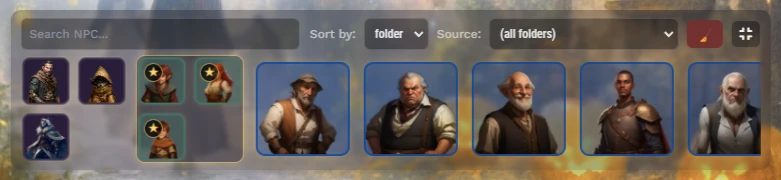

  

# Ginzzzu's Portraits & NPC Dock
A system-agnostic Foundry VTT module that brings a cinematic layer to your Foundry VTT games.
It displays character and NPC portraits directly on screen — much like a visual novel or dialogue-driven RPG. 

The module provides:

🎭 Dynamic portraits for PCs and NPCs with smooth animation transitions and emotions.

💬 NPC Dock, a visual panel bar for managing and displaying characters on screen that remembers sorting between worlds, supports folder-based sorting etc.

⚙️ Customizable layout, including sliders for portrait size, spacing, and screen offsets.

✨ Stylized UI with glass panels, glowing edges, and adaptive transparency.

💖 Direct portrait controls, including synchronized drag reorder, optional manual position, scale, tilt, and permission-aware access.

This module integrates seamlessly with other Foundry features and can be used both for roleplay storytelling and combat visualization for any gaming system.

## Installation
1. Copy https://github.com/Oxy949/ginzzzu-portraits/releases/latest/download/module.json
2. Paste it in your Foundry VTT, wait for install
3. Enable the module in your world
4. Enjoy!

# Usage
After installing, you’ll find a PC/NPC control panel at the bottom of your screen — an intuitive way to manage all your character portraits right on the tabletop.

## Panel controls
- **Left-click** — add or remove portraits on the screen.
- **Hold the configured panel modifier and left-click** — open the character sheet. Default: `Ctrl` / `Cmd`.
- **Right-click** — open the character sheet for any PC or NPC.
- **Middle-click** — add PCs or NPCs to **Favorites** to keep important characters at the front.
- **Drag** actor cards from the dock onto the canvas to create tokens.
- **Scroll** the mouse wheel to browse portraits.
- **Clear the screen** by pressing the `Clear All` button (red, top-right).
- **Toggle panel visibility** by pressing the `Show/Hide Panel` button (gray, top-right).
- **Folder selection**: use the folder dropdown to select an **actors** folder with portraits.
- **Sorting**: order portraits by name, folder name, or the manual/alphabetical folder order configured in Foundry.
- **Quick search**: use `Search` field to filter portraits by name or folder path.

## Portrait controls
- **Middle-click a portrait** to highlight it and dim the others (adjustable in `Settings`).
- Move cursor over portrait to see character's name (can switch to permament visibility in settings).
- **Right-click to flip** portrait horizontally (players can flip their characters)
- **Hold the configured action modifier and left-click a portrait** to hide it. Default: `Ctrl` / `Cmd`.
- **Hold the configured action modifier and right-click a portrait** to open its actor sheet. Default: `Ctrl` / `Cmd`.
- **Drag a portrait** left or right to reorder active portraits on the screen. The shared order is synchronized through the scene and restored when the canvas loads.
- **Hold the configured keep-position key** when releasing a dragged portrait to keep its manual position, scale, and tilt instead of returning to the automatic layout. Default: `Shift`.
- When **Reset position on release** is disabled, **double-click a portrait** to reset its manual position, scale, and tilt.
- **Use the mouse wheel while dragging** to scale the portrait.
- **Hold the configured transform key** while dragging to adjust scale and tilt without changing the reorder target. Default: `Alt`.

## Emotion panel
You can now assign expressive emotional states to any portrait. Check settings to switch on/off and allow players to use it.
Supported emotions include:
😊 Joy • 😢 Sadness • 😠 Anger • 😱 Fear • 💖 Love • 🤕 Hurt • 😪 Tired

Each emotion applies: color-grade filter, glowing highlight, a unique animated behavior (shake, tilt, bob, pulse, etc.).

How to use:
- Hover over a portrait to reveal the Emotion Panel
- Click an icon to apply an emotion
- Click the same icon again to remove it
- All connected users see the emotion and animation immediately

### Linked token art
Enable **Sync linked token art with portraits** in the module's **Emotions** settings to use the current portrait image for tokens with **Link Actor Data** enabled. This world setting is **off by default** and takes effect without a reload.

Custom emotion images, the custom portrait, and the base portrait use the same priority as the portrait display. Clearing an emotion returns tokens to the current custom or base portrait. Existing linked tokens on all scenes and newly placed linked tokens are synchronized, including dynamic token ring subjects. Unlinked tokens, actor images, and prototype tokens are left unchanged. Disabling synchronization keeps the last token image.

Token images use Foundry's native fade transition, with the duration from **Portrait image transition speed** (0 disables animation). With **Perspective Levels**, the portrait and emotion height multipliers scale the token art together while keeping its ground footprint and shadow unchanged. This requires the updated integration in Perspective Levels.

Only the active GM sends updates; without a connected GM, the owner changing the portrait updates tokens they can modify. Rapid changes are combined within 50 ms and token updates are batched per scene, skipping unchanged images. There is no polling or scene-wide search on emotion changes.

## Character settings
- Change displayed name in Player/NPC Sheet > Settings (3 dots in top right) > Configure Character Portrait.

In the module's portrait layout settings, **Left offset (%)**, **Right offset (%)**, and **Bottom offset (%)** accept values from **-100 to +100**, with 0 preserving the default layout. Side offsets use window width: positive values inset the portrait area, negative values extend it past the screen edges. The bottom offset uses window height: positive values lift portraits, negative values lower them without changing their art height. Changes apply without a reload and scale when the window is resized. The existing pixel bottom offset remains additive. These layout offsets do not affect token art, token dimensions, or Perspective Levels scaling.

In **Visual novel mode**, portraits stand on one shared floor. Outside novel mode, they are anchored at the vertical center as before. Configured height comes from the window-height setting, the actor's multiplier, and the emotion multiplier. Tall characters may extend above the screen; negative bottom offsets can place feet below the screen. Idle breathing scales from the feet in novel mode; deliberate dragging and emotion movement can still move a character away from its anchor.

**Shrink to fit the row** works in both modes and applies without a reload. When enabled, it fits actual image dimensions into separate, equally wide frames, reducing width and height by one common scale so characters keep their relative heights. Changing emotion art recalculates the fit using the new image dimensions. To keep heights fixed regardless of character count, disable this option: portraits then retain their configured size and may overlap. Vertical offsets affect placement only; side offsets and the sidebar determine the available width for fitting. This screen-only fitting never resizes scene tokens.

## Useful tips
- Folder colors match each portrait’s background or outline for quick visual grouping.
- Filter player characters by placing them in different folders and choose certait folder in the module settings. Drag the actor into the selected folder so it will instantly appear in the dock — no reload required. 
- Use the `(Scene)` option to show portraits only for characters with tokens on the current scene.
- Dynamic lighting support: portraits dim with scene darkness for deeper immersion (adjustable in `Settings`).
- In `Settings`, use **Who can drag portraits**, **Animate portrait dragging**, and **Reset position on release** to tune the new portrait dragging behavior for your table.
- Use Foundry's **Configure Controls** menu to remap panel and portrait modifiers separately.
- Right-click an actor in the **Actors** list (top-right panel) and select **“Show portrait”**, or use the top-right button in the character sheet to instantly display the portrait.
- Use `Settings` to configure the module to your preferences.

The NPC rail, player panel, and favorites render only visible cards with a small scroll buffer. Filtering and sorting still use the complete actor list; offscreen actors create no card or image elements. Preview images load lazily and decode asynchronously. Name labels are measured before styles are written, and drag frames measure only moving portraits. These paths avoid repeated layout work as the number of characters grows.

Run `node --experimental-vm-modules --test "tests/*.test.mjs"` to check token art synchronization and name layout with Node.js 24 or newer.

For a browser layout check, serve the project directory locally and open `tests/fixtures/dock-grid.html`. It uses the module's real dock CSS and virtual grid with 5000 actors, row-count controls, scrolling, filtering, and panel visibility controls.

## Credits
- [Ginzzzu](https://boosty.to/Ginzzzu) - Original idea, core code and design
- [Oxy949](https://boosty.to/oxy949) - The module code, refactoring, bugfixes
- [gludington](https://github.com/gludington) - Help with system-dependent logic
- [Threatre Inserts](https://foundryvtt.com/packages/theatre) - Heavy inspiration *(and little bit'o code's reference)*
